<div align="center">


# YOGO Campus

**Your campus, simplified.** One app for everyday student life: mess menus, ride sharing, a campus marketplace, bill splitting, timetables, Q&A and more.


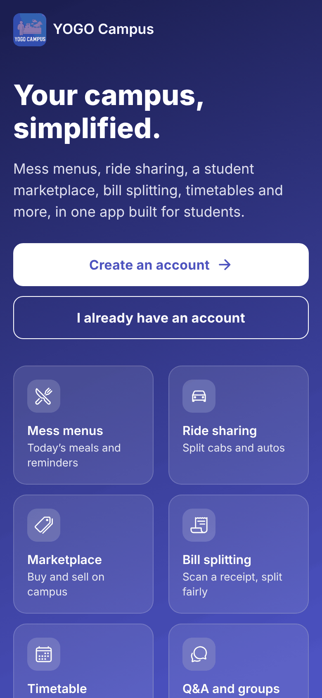
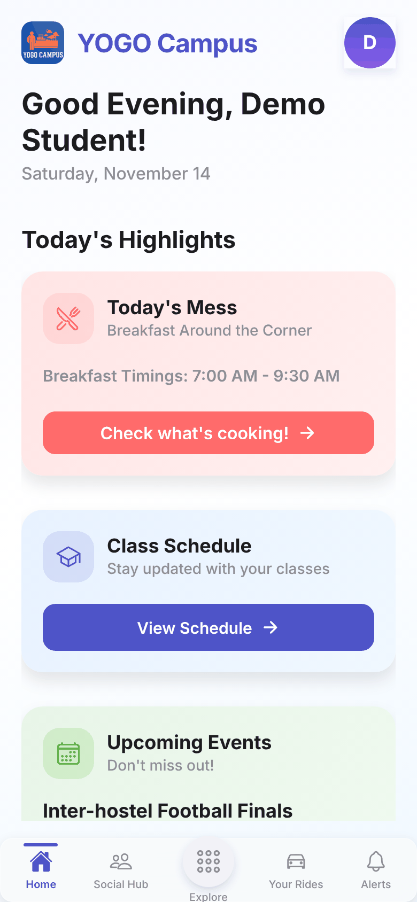
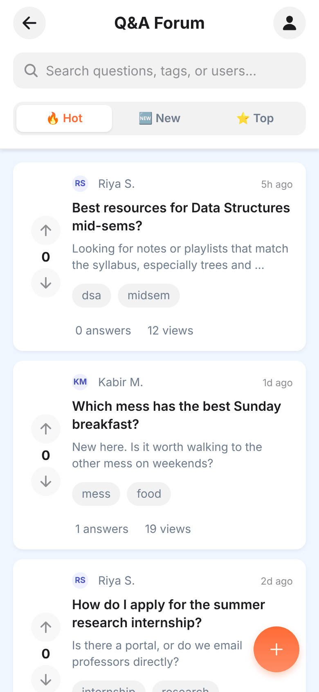

</div>

---

## Contents

- [Overview](#overview)
- [Screenshots](#screenshots)
- [Features](#features)
- [Tech stack](#tech-stack)
- [Architecture](#architecture)
- [Design system and accessibility](#design-system-and-accessibility)
- [Project structure](#project-structure)
- [Getting started](#getting-started)
- [Configuration](#configuration)
- [Running the app](#running-the-app)
- [Usage walkthrough](#usage-walkthrough)
- [Scripts](#scripts)
- [Data model and external APIs](#data-model-and-external-apis)
- [URLs and deep links](#urls-and-deep-links)
- [Testing](#testing)
- [Linting and formatting](#linting-and-formatting)
- [Deployment](#deployment)
- [Troubleshooting and FAQ](#troubleshooting-and-faq)
- [Known limitations](#known-limitations)
- [Roadmap ideas](#roadmap-ideas)
- [Contributing](#contributing)
- [License](#license)

## Overview

Campus life runs on a dozen WhatsApp groups, notice boards and spreadsheets: what the mess is serving, who is splitting a cab to the airport, who is selling a drafter kit, who owes what after dinner, and when the next class starts. **YOGO Campus** puts those everyday tasks into one signed-in app for students.

- **Who it's for:** college students (the defaults are tuned for Manipal Institute of Technology, but nothing is hard-wired to one campus), and student developers who want a real-world React Native + Firebase codebase to learn from or extend.
- **What it is:** a cross-platform app for iOS, Android and the web, built with Expo and React Native. It talks to Firebase directly (Authentication, Cloud Firestore, Realtime Database, Cloud Storage); there is no custom backend server.
- **What it isn't (yet):** a hardened public product. See [Known limitations](#known-limitations).

## Screenshots

All screenshots below were captured from the production web build running against the local Firebase emulators with the demo seed data (`npm run seed:emulator`). No real people or contact details appear.

| Splash                                                                                   | Landing                                                                                              | Sign-up validation                                                                                                         | Log-in error                                                                                               |
| ---------------------------------------------------------------------------------------- | ---------------------------------------------------------------------------------------------------- | -------------------------------------------------------------------------------------------------------------------------- | ---------------------------------------------------------------------------------------------------------- |
| 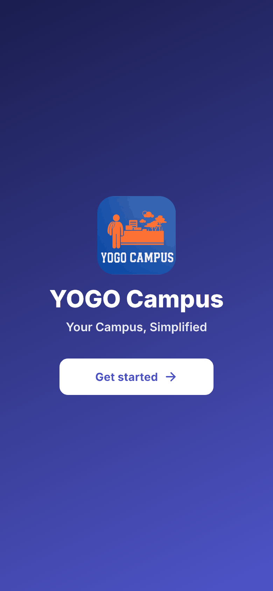 |  | 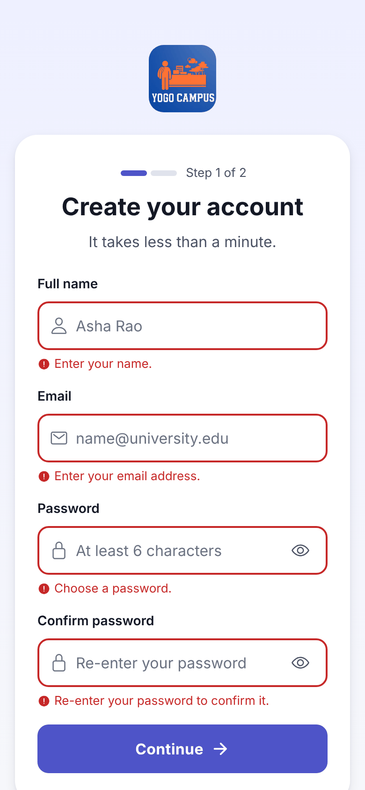 | 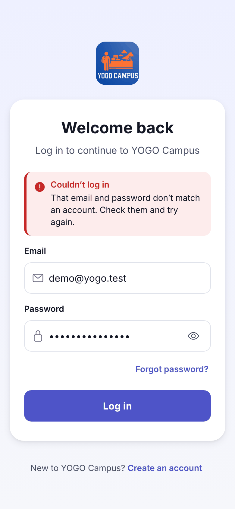 |

| Home                                                                           | Marketplace                                                                                                | Q&A forum                                                                     | Lost & Found                                                                                   |
| ------------------------------------------------------------------------------ | ---------------------------------------------------------------------------------------------------------- | ----------------------------------------------------------------------------- | ---------------------------------------------------------------------------------------------- |
|  | 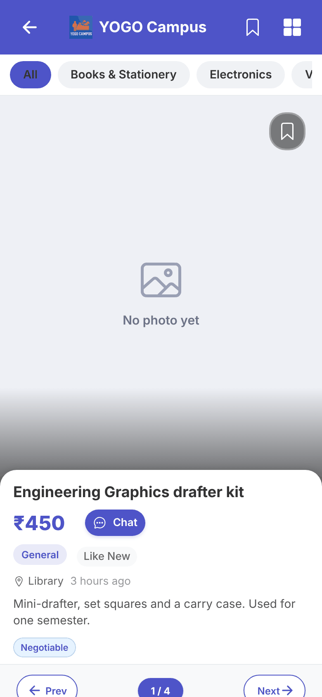 |  | 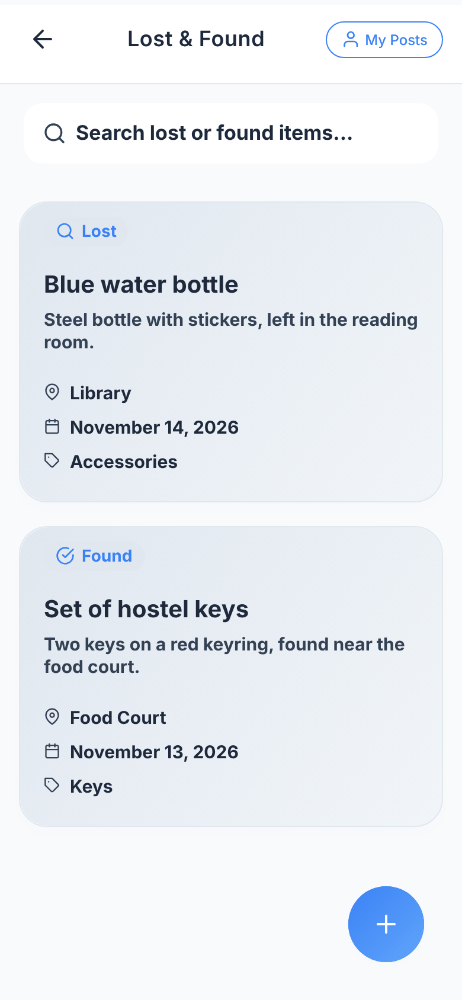 |

| Events                                                                               | Cab share                                                                          | Sign-up on a tablet (768 px)                                                                        |
| ------------------------------------------------------------------------------------ | ---------------------------------------------------------------------------------- | --------------------------------------------------------------------------------------------------- |
| 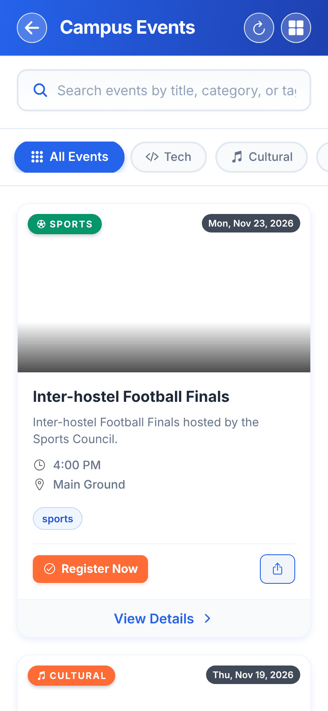 | 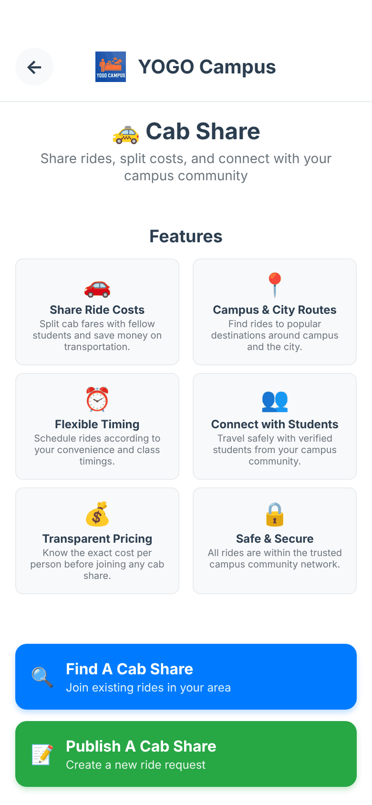 | 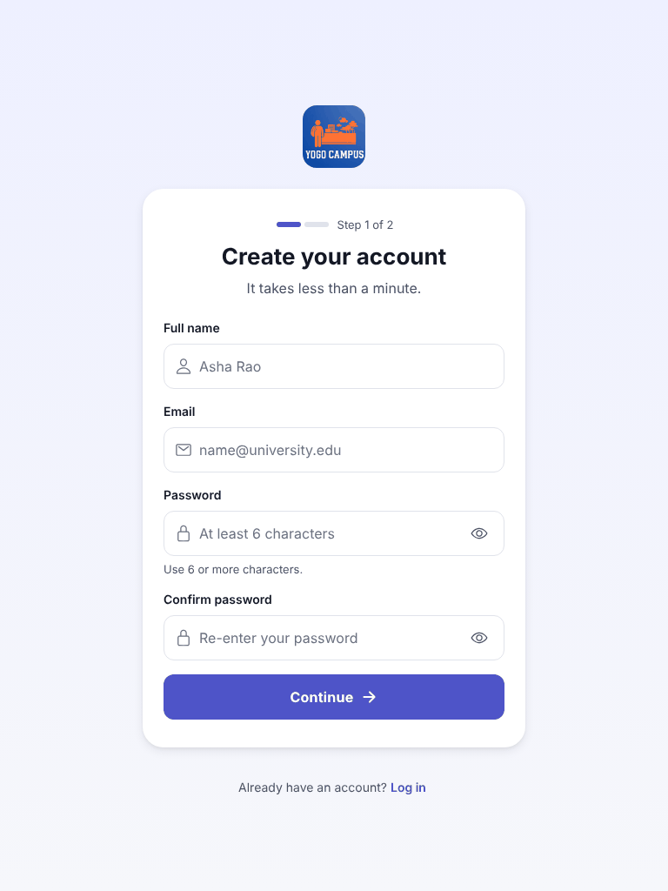 |

**Desktop (1280 px)**

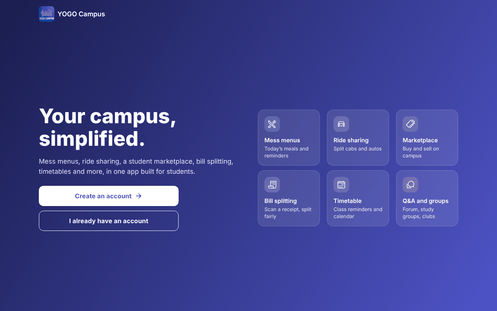

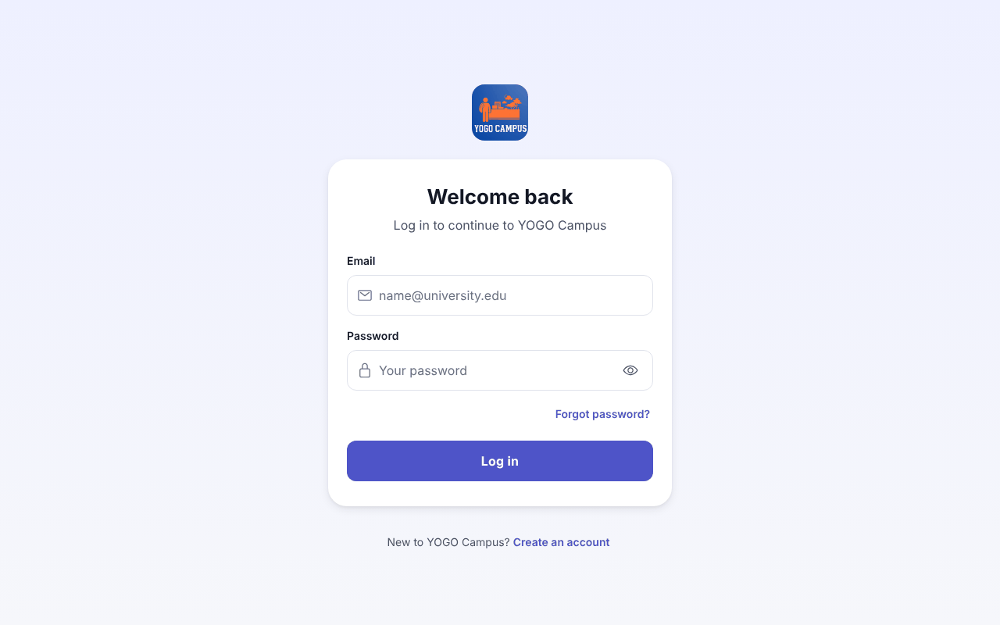 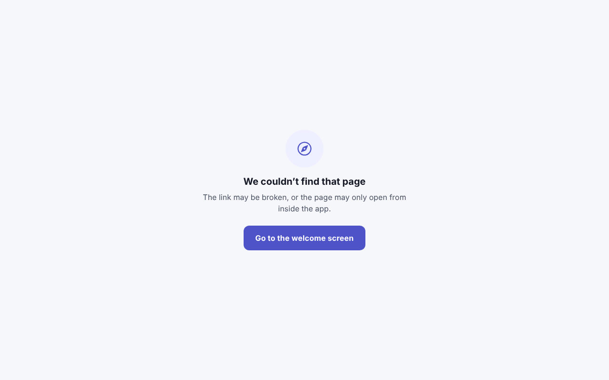

## Features

Every feature below exists in the code today. Features marked _needs a key_ depend on a third-party API key (see [Configuration](#configuration)) and degrade gracefully without it.

| Area                    | What you can do                                                                                                                                                                    |
| ----------------------- | ---------------------------------------------------------------------------------------------------------------------------------------------------------------------------------- |
| **Accounts**            | Two-step sign-up (name/email/password, then username, phone, college and branch), log in, password reset by email. Sessions persist across restarts.                               |
| **Home dashboard**      | Greeting, today's mess timing, class schedule, the next event, academic-calendar countdown, weather, points and badges; tabs for Social Hub and rides.                             |
| **Food**                | Mess menus (veg / non-veg) per mess, meal-time notifications, dish "hearts", and a restaurants directory.                                                                          |
| **Ride sharing**        | Auto share and cab share: publish a ride, search for matching rides, join, see seats left and fare per person, chat with the ride group, "Your Rides".                             |
| **Marketplace**         | Sell items with photos (Cloud Storage), browse in card or grid view by category, bookmark, and chat with the seller.                                                               |
| **Lost & Found**        | Post lost or found items with location, date and an optional secret phrase to verify the owner.                                                                                    |
| **Smart bill splitter** | Photograph a receipt, extract items with OCR (_needs a key_: OCR.space) and AI parsing (_needs a key_: OpenRouter, with a rule-based fallback), assign items and split tax fairly. |
| **Academics**           | Timetable extraction from a photo (_needs a key_: Google Gemini), daily timetable with class reminders, academic calendar, previous-year papers.                                   |
| **Community**           | Q&A forum with votes, answers and reputation; study groups; club recruitment; roommate finder with chat; sports places and groups; campus events.                                  |
| **AI assistant**        | Text assistant via OpenRouter with model fallbacks (_needs a key_), and an optional Tavus video assistant (_needs a key_).                                                         |
| **Gamification**        | Points for actions, daily streaks and unlockable badges.                                                                                                                           |
| **Web extras**          | Real URLs for every screen, browser back/forward, a 404 page, page titles, social-preview tags, and keyboard navigation with visible focus.                                        |

## Tech stack

| Layer         | Technology                                                                                       | Notes                                                               |
| ------------- | ------------------------------------------------------------------------------------------------ | ------------------------------------------------------------------- |
| App framework | [Expo SDK 53](https://docs.expo.dev/), React Native 0.79, React 19                               | New Architecture enabled; one codebase for iOS, Android and web     |
| Language      | TypeScript 5.8 (strict)                                                                          | `npm run typecheck` must pass                                       |
| Web           | react-native-web 0.20, Metro web bundler                                                         | Single-page app output (`expo export --platform web`)               |
| Navigation    | React Navigation 7 (native stack) + linking config                                               | URL per screen on web, `yogo://` deep links on native               |
| Backend       | Firebase Authentication, Cloud Firestore, Realtime Database, Cloud Storage (JS SDK v11)          | Security rules in this repo; Emulator Suite supported for local dev |
| AI / OCR      | Google Gemini (`@google/generative-ai`), OpenRouter, OCR.space, Tavus, WeatherAPI.com            | All optional                                                        |
| Device APIs   | Expo Image Picker, Notifications, Location, Haptics, Linear Gradient, Blur                       |                                                                     |
| Animation     | React Native Reanimated 3, Moti                                                                  | Respects the OS "reduce motion" setting on the splash screen        |
| UI foundation | Design tokens (`src/theme`) and primitives (`src/components/ui`)                                 | See [Design system](#design-system-and-accessibility)               |
| Quality       | ESLint 9 (`eslint-config-expo`), Prettier 3, Jest 29 (`jest-expo`), React Native Testing Library | Run locally and in GitHub Actions                                   |

## Architecture

YOGO Campus is a **client-only** app: every screen talks to Firebase with the modular JS SDK, and optional third-party APIs are called straight from the client.

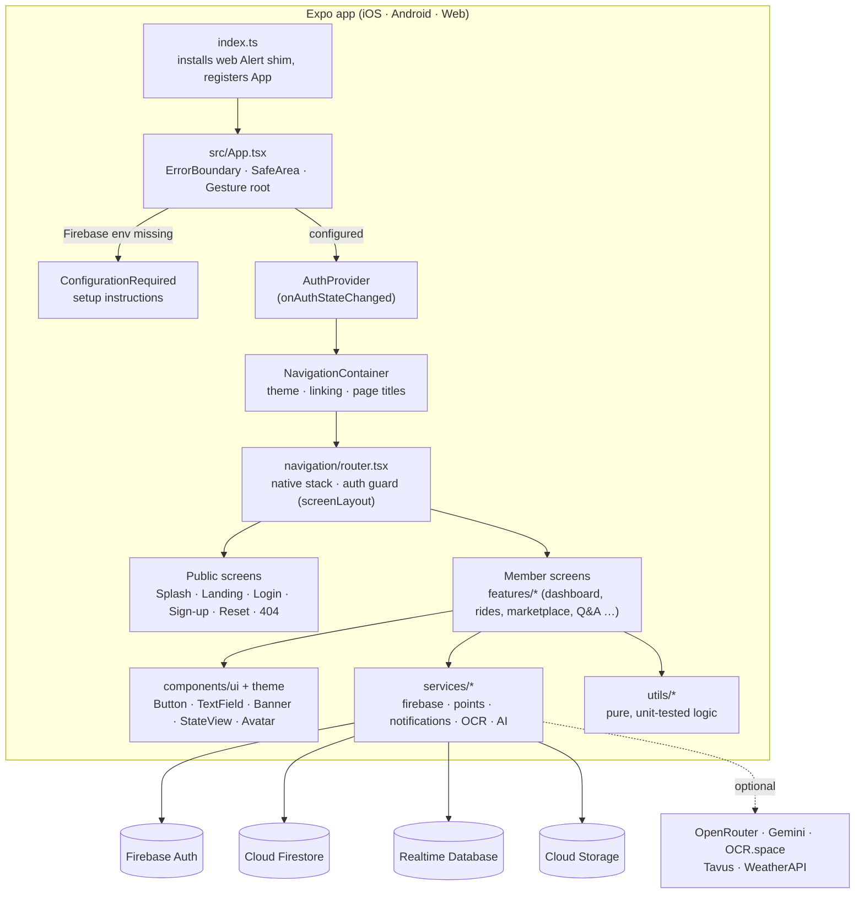

**Sign-in and routing flow**

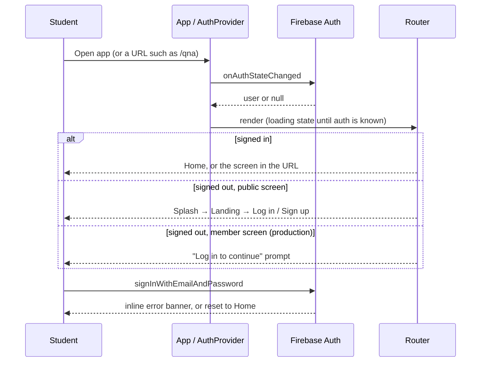

Key decisions:

- **Configuration gate.** `src/config/firebaseConfig.ts` validates the `EXPO_PUBLIC_FIREBASE_*` variables. If any are missing, the app shows a setup screen that lists them instead of crashing.
- **Auth.** `AuthContext` follows Firebase Auth. On iOS/Android the session is persisted with AsyncStorage; on the web Firebase uses IndexedDB.
- **Auth guard.** The router's `screenLayout` replaces member-only screens with a "Log in to continue" prompt when someone opens their URL while signed out. Development builds skip the guard so screens can be previewed with the dev-only "Skip" button.
- **Errors never blank the screen.** A top-level `ErrorBoundary` shows a recovery screen if any screen throws while rendering.
- **Web dialogs.** react-native-web implements `Alert.alert` as a no-op, so `src/utils/webAlert.ts` maps it to the browser's `alert`/`confirm`. Without it, every confirmation and error message in the app would silently vanish on the web.
- **API keys.** Third-party keys come from `EXPO_PUBLIC_*` variables or, after sign-in, the Firestore document `api_keys/keys` (`services/apiKeysService.ts`).
- **Testable logic lives in `src/utils`,** away from screens, so it can be unit-tested without Firebase or a device.

## Design system and accessibility

New and refactored screens build on shared tokens and primitives instead of one-off styles.

**Tokens** (`src/theme/index.ts`)

| Token group | Values                                                                                                                                                                                                              |
| ----------- | ------------------------------------------------------------------------------------------------------------------------------------------------------------------------------------------------------------------- |
| Colour      | Brand indigo `#4E54C8` (6.1:1 on white), logo blue `#1A53AC`, accent orange `#FF7533`, neutral greys, semantic danger / success / warning, each paired with a soft background. Text colours meet WCAG AA (≥ 4.5:1). |
| Spacing     | 4-point scale: 2, 4, 8, 12, 16, 24, 32, 48                                                                                                                                                                          |
| Radius      | 8, 12, 16, 24, pill                                                                                                                                                                                                 |
| Typography  | display 34/40, title 26/32, heading 20/26, subheading 17/24, body 16/24, label 14/20, caption 13/18                                                                                                                 |
| Elevation   | `sm` and `md` shadows (CSS `box-shadow` on web, native shadow/elevation on iOS/Android)                                                                                                                             |
| Layout      | Form column 440 px, content 720 px, wide 1080 px; minimum touch target 48 px                                                                                                                                        |

**Primitives** (`src/components/ui`)

| Component    | What it gives you                                                                                                                                                         |
| ------------ | ------------------------------------------------------------------------------------------------------------------------------------------------------------------------- |
| `Button`     | primary / secondary / ghost / danger / inverse / outline-inverse variants; ≥ 48 px tall; pressed, hover and loading states; `busy`/`disabled` announced to screen readers |
| `TextField`  | Visible label used as the accessible name, icon, hint, inline error announced as an alert, focus ring, password show/hide toggle                                          |
| `Banner`     | Inline error / success / info / warning messages (used instead of `Alert.alert` for form feedback)                                                                        |
| `StateView`  | Consistent loading, empty and error states with optional actions                                                                                                          |
| `AuthLayout` | Shared shell for log-in, sign-up and reset: full width on phones, a centred card on tablets and desktop                                                                   |
| `Avatar`     | Profile photo, or initials when there is none                                                                                                                             |

**Accessibility checklist** (what the shared pieces and the redesigned entry/auth screens do):

- Semantic roles: headers, buttons, links, alerts, progress bars, switches.
- Every input has a visible label that is also its accessible name; validation errors are announced.
- Visible keyboard focus everywhere on the web (`:focus-visible` outline in `public/index.html`), logical tab order, Enter submits forms.
- Touch targets of at least 48 px for buttons and toggles.
- `prefers-reduced-motion` is respected on the web, and the splash animation is skipped when the OS asks to reduce motion.
- The web build sets `lang`, a page title per screen (`<Screen> · YOGO Campus`), a meta description, theme colour, Open Graph and Twitter card tags, an Apple touch icon, and a branded loading screen shown until the JavaScript has loaded.

## Project structure

```text
.
├── index.ts                     # Entry: installs the web Alert shim, registers src/App
├── app.json                     # Expo config: name, icons, splash, plugins, web metadata
├── public/
│   ├── index.html               # Web HTML template: meta/OG tags, focus styles, boot screen
│   ├── og-image.png             # 1200×630 social preview image
│   └── apple-touch-icon.png
├── assets/
│   ├── images/                  # App icon, adaptive icon, splash, favicon, logo
│   ├── Badges/                  # Achievement badge artwork
│   └── Badges-Points/           # Points-tier artwork
├── docs/screenshots/            # README screenshots (captured from the running app)
├── scripts/
│   └── seed-emulator.mjs        # Seeds the Firebase emulators with demo data
├── firebase.json                # Firebase CLI: rules files + emulator ports
├── firestore.rules              # Firestore security rules
├── storage.rules                # Cloud Storage security rules
├── database.rules.json          # Realtime Database rules
├── firestore-data/              # Example shape of the api_keys/keys document
├── src/
│   ├── App.tsx                  # Providers, error boundary, config gate, navigation container
│   ├── theme/                   # Design tokens: colour, spacing, radius, type, elevation
│   ├── components/
│   │   ├── ui/                  # Button, TextField, Banner, StateView, AuthLayout, Avatar
│   │   ├── ConfigurationRequired.tsx  # Setup screen when Firebase env vars are missing
│   │   ├── ErrorBoundary.tsx    # Recovery screen for render errors
│   │   ├── SignInRequired.tsx   # Shown for member screens opened while signed out
│   │   └── Collapsible.tsx, Themed*.tsx
│   ├── config/                  # Environment/config parsing (firebaseConfig.ts)
│   ├── constants/               # App constants
│   ├── context/                 # AuthContext (Firebase Auth state)
│   ├── data/calendars/          # Academic calendar JSON (ships empty)
│   ├── features/                # One screen per file
│   │   ├── auth/                # Login, SignUp, Forgot
│   │   ├── AnimatedEntry.tsx    # Splash
│   │   ├── LandingScreen.tsx    # Landing (Pathway.tsx re-exports it)
│   │   ├── Dashboard.tsx        # Home with Social Hub / rides / alerts tabs
│   │   ├── NotFound.tsx         # 404
│   │   └── …                    # Rides, marketplace, Q&A, events, mess, bill split, …
│   ├── hooks/                   # Shared hooks (useWeather)
│   ├── navigation/
│   │   ├── router.tsx           # Stack navigator, route params, auth guard
│   │   └── linking.ts           # URL ↔ screen mapping, 404 handling
│   ├── services/                # Firebase, points, notifications, OCR, OpenRouter, Gemini
│   ├── types/                   # Shared TypeScript types
│   └── utils/                   # Pure logic: calendar, bill split, rides, auth errors, web alerts
└── .github/workflows/ci.yml     # CI: lint, format, typecheck, tests, web + Android bundles
```

## Getting started

### Prerequisites

| Tool                | Version                         | Why                                                                     |
| ------------------- | ------------------------------- | ----------------------------------------------------------------------- |
| Node.js + npm       | 20 or newer (22 in `.nvmrc`)    | Install and run the tooling                                             |
| A Firebase project  | Any plan                        | Auth (Email/Password), Firestore, Realtime Database and Storage enabled |
| _or_ Java 11+       | For the Firebase Emulator Suite | Run everything locally without a cloud project                          |
| Expo Go / dev build | Latest                          | Run on a phone; Xcode or Android Studio for simulators                  |

### 1. Install

```bash
git clone https://github.com/jeevithg090/YC-Final-Version.git
cd YC-Final-Version
nvm use            # optional: switches to the Node version in .nvmrc
npm ci
```

### 2. Choose a backend

**Option A: local emulators (no cloud account needed).** Good for development and demos.

```bash
cp .env.example .env
```

Put any non-empty values in the seven required `EXPO_PUBLIC_FIREBASE_*` variables (for example `EXPO_PUBLIC_FIREBASE_PROJECT_ID=demo-yogo`), then set:

```dotenv
EXPO_PUBLIC_FIREBASE_PROJECT_ID=demo-yogo
EXPO_PUBLIC_FIREBASE_DATABASE_URL=https://demo-yogo-default-rtdb.firebaseio.com
EXPO_PUBLIC_USE_FIREBASE_EMULATOR=true
```

Start the emulators and load the demo data in a second terminal:

```bash
npm run emulators        # = npx firebase-tools emulators:start --project demo-yogo
npm run seed:emulator    # demo users, listings, questions, lost & found posts, events
```

Sign in with **`demo@yogo.test` / `demo1234`**. The emulator UI is at http://localhost:4000. The seed script refuses to run against any project whose ID doesn't start with `demo-`.

**Option B: a real Firebase project.**

1. Create a project in the [Firebase console](https://console.firebase.google.com/) and add a **Web app**.
2. Enable **Authentication → Email/Password**, **Cloud Firestore**, **Realtime Database** and **Storage**.
3. `cp .env.example .env` and paste the web app config into the `EXPO_PUBLIC_FIREBASE_*` variables.
4. Deploy the security rules in this repo:

   ```bash
   npx firebase-tools login
   npx firebase-tools use <your-project-id>
   npx firebase-tools deploy --only firestore:rules,storage,database
   ```

5. Optional: create the Firestore document `api_keys/keys` with the shape in [`firestore-data/api_keys.json`](firestore-data/api_keys.json) instead of putting third-party keys in `.env`.

Collections such as `users`, `products`, `cab_rides` and `qna_questions` are created on first write.

### 3. Academic calendar data (optional)

The academic calendar reads `src/data/calendars/MITCalendar.json` and `src/data/calendars/ICAS.json`. They ship empty (`{ "months": [] }`). Fill them with your institution's dates:

```json
{
  "months": [
    {
      "name": "August",
      "events": [{ "date": "1", "day": "Fri", "event": "Commencement of classes" }]
    }
  ]
}
```

Month names are full English names; the academic year runs July–June.

## Configuration

Expo reads `.env` automatically. Every `EXPO_PUBLIC_*` value is inlined into the bundle at build time, so **restart the dev server with a cleared cache (`npx expo start -c`) after changing it**.

| Variable                                   | Required | Default     | Description                                                                             |
| ------------------------------------------ | -------- | ----------- | --------------------------------------------------------------------------------------- |
| `EXPO_PUBLIC_FIREBASE_API_KEY`             | Yes      | –           | Firebase web config                                                                     |
| `EXPO_PUBLIC_FIREBASE_AUTH_DOMAIN`         | Yes      | –           | Firebase web config, e.g. `my-app.firebaseapp.com`                                      |
| `EXPO_PUBLIC_FIREBASE_DATABASE_URL`        | Yes      | –           | Realtime Database URL (weather and mess data)                                           |
| `EXPO_PUBLIC_FIREBASE_PROJECT_ID`          | Yes      | –           | Firebase project ID (`demo-…` for the emulators)                                        |
| `EXPO_PUBLIC_FIREBASE_STORAGE_BUCKET`      | Yes      | –           | Cloud Storage bucket for image uploads                                                  |
| `EXPO_PUBLIC_FIREBASE_MESSAGING_SENDER_ID` | Yes      | –           | Firebase web config                                                                     |
| `EXPO_PUBLIC_FIREBASE_APP_ID`              | Yes      | –           | Firebase web config                                                                     |
| `EXPO_PUBLIC_FIREBASE_MEASUREMENT_ID`      | No       | unset       | Google Analytics measurement ID                                                         |
| `EXPO_PUBLIC_OPENROUTER_API_KEY`           | No       | unset       | AI assistant and AI receipt parsing ([OpenRouter](https://openrouter.ai))               |
| `EXPO_PUBLIC_OCR_API_KEY`                  | No       | unset       | Receipt text extraction ([OCR.space](https://ocr.space/ocrapi))                         |
| `EXPO_PUBLIC_GEMINI_API_KEY`               | No       | unset       | Timetable extraction from photos ([Google AI Studio](https://aistudio.google.com))      |
| `EXPO_PUBLIC_TAVUS_API_KEY`                | No       | unset       | Video assistant ([Tavus](https://tavus.io))                                             |
| `EXPO_PUBLIC_WEATHER_API_KEY`              | No       | unset       | Live weather ([WeatherAPI.com](https://www.weatherapi.com))                             |
| `EXPO_PUBLIC_USE_FIREBASE_EMULATOR`        | No       | `false`     | `true` connects Auth, Firestore, Realtime Database and Storage to the local emulators   |
| `EXPO_PUBLIC_FIREBASE_EMULATOR_HOST`       | No       | `127.0.0.1` | Host running the emulators; use your computer's LAN IP when testing on a physical phone |

> **Security:** `EXPO_PUBLIC_*` values are visible to anyone who inspects the app bundle. That is expected for the Firebase web config, which is protected by security rules. For the paid third-party APIs, set usage quotas, and for a public release move those calls behind a server (for example Cloud Functions).

Other configuration lives in `app.json` (app name, bundle identifiers, icons, splash colour, notification icon, web metadata) and `firebase.json` (rules files and emulator ports: Auth 9099, Firestore 8080, Realtime Database 9000, Storage 9199, UI 4000).

## Running the app

### Development

```bash
npm start          # Expo dev server; press w (web), i (iOS simulator) or a (Android)
npm run web        # straight into the browser at http://localhost:8081
npm run ios        # iOS simulator (macOS + Xcode)
npm run android    # Android emulator or a connected device
```

Development builds show a **Skip (dev)** button on the landing screen and the `/dev/api-keys` bootstrap screen. Both are compiled out of production builds.

### Production (web)

```bash
npm run build:web                 # static SPA in dist/
npx serve -s dist                 # any static server with an index.html fallback
```

If you changed `.env` since the last build, run `npx expo export --platform web --clear` so the new values are inlined.

### Production (iOS / Android)

Build with [EAS Build](https://docs.expo.dev/build/introduction/), see [Deployment](#deployment).

## Usage walkthrough

1. **First launch.** The splash screen animates in (skipped if the OS asks to reduce motion). Tap **Get started**.
2. **Landing.** A short overview of what the app does, with **Create an account** and **I already have an account**.
3. **Sign up.** Step 1 asks for name, email and password; step 2 for username, mobile number (`+91` and 10 digits), college and branch (type it, or **Choose from common branches**). Accept the terms and tap **Create account**. Problems are shown inline next to the field; an email that is already registered sends you back to step 1 with a banner.
4. **Log in / reset password.** Wrong credentials show a banner that doesn't reveal whether the email exists. **Forgot password?** sends a reset link and shows the same confirmation whether or not an account exists.
5. **Home.** Today's mess timing, class schedule, the next event and your points. The bottom bar switches between Home, Social Hub, Explore, Your Rides and Alerts.
6. **Try the seeded data** (emulator mode): browse the marketplace at `/marketplace/buy`, the Q&A forum at `/qna`, Lost & Found at `/lost-and-found` and events at `/events`.
7. **Share a cab.** Rides → Cab share → **Publish a cab share** (destination, time, seats, fare). Others find it under **Find a cab share**, join, and chat in the ride's group chat.

## Scripts

| Command                 | Description                                                         |
| ----------------------- | ------------------------------------------------------------------- |
| `npm start`             | Start the Expo dev server                                           |
| `npm run web`           | Start the dev server and open the web app                           |
| `npm run ios`           | Start the dev server and open the iOS simulator                     |
| `npm run android`       | Start the dev server and open Android                               |
| `npm run emulators`     | Start the Firebase Emulator Suite (project `demo-yogo`, needs Java) |
| `npm run seed:emulator` | Load demo users and content into the running emulators              |
| `npm run lint`          | ESLint (`eslint-config-expo` + Prettier compatibility)              |
| `npm run lint:fix`      | ESLint with auto-fix                                                |
| `npm run format`        | Format every file with Prettier                                     |
| `npm run format:check`  | Check formatting without writing                                    |
| `npm run typecheck`     | TypeScript type-check (`tsc --noEmit`)                              |
| `npm test`              | Unit and component tests (Jest)                                     |
| `npm run test:ci`       | Tests in CI mode with a coverage report                             |
| `npm run build:web`     | Export the static web build to `dist/`                              |

## Data model and external APIs

There is no custom HTTP API: the app reads and writes Firebase directly. These are the main Firestore collections the screens use.

| Collection                                                                                         | Used by                             | Notes                                                                 |
| -------------------------------------------------------------------------------------------------- | ----------------------------------- | --------------------------------------------------------------------- |
| `users/{uid}`                                                                                      | Sign-up, profile, Q&A reputation    | Only the owner can edit; others may only change `reputation`/`points` |
| `products`, `product_chats`                                                                        | Marketplace                         | Listing photos are stored in Cloud Storage                            |
| `cab_rides`, `published_rides`, `user_rides`, `cab_share_requests`                                 | Cab share                           |                                                                       |
| `auto_rides`, `user_auto_rides`                                                                    | Auto share                          |                                                                       |
| `qna_questions`, `qna_answers`                                                                     | Q&A forum                           | Votes stored as arrays of user IDs                                    |
| `lost_and_found`                                                                                   | Lost & Found                        |                                                                       |
| `events`, `club_recruitment`                                                                       | Events, clubs                       |                                                                       |
| `messMenu`, `restaurants`, `alerts`                                                                | Food, alerts                        |                                                                       |
| `groups`, `group_chats`, `direct_chats`, `social_posts`, `study_groups_general_chat`               | Social Hub, study groups            |                                                                       |
| `roommate_chats`                                                                                   | Roommate finder                     |                                                                       |
| `sports_groups`, `sports_posts`, `sports_matches`, `match_results`, `sports_leaderboard`           | Sports                              |                                                                       |
| `billSplits`, `extracted_timetables`, `user_points`, `user_stats`, `recent_activities`, `feedback` | Bill split, timetable, gamification |                                                                       |
| `api_keys/keys`                                                                                    | `apiKeysService`                    | Readable by signed-in users, never writable from the client           |

Realtime Database is used for `weather_data` (and other legacy live data). Cloud Storage holds marketplace and profile images (images only, under 10 MB, enforced by `storage.rules`).

**Third-party HTTP APIs called from the client**

| Service       | Endpoint                                             | Auth                                    | Used for                         |
| ------------- | ---------------------------------------------------- | --------------------------------------- | -------------------------------- |
| OpenRouter    | `POST https://openrouter.ai/api/v1/chat/completions` | Bearer `EXPO_PUBLIC_OPENROUTER_API_KEY` | AI assistant, receipt parsing    |
| OCR.space     | `POST https://api.ocr.space/parse/image`             | `apikey` form field                     | Receipt OCR                      |
| Google Gemini | `@google/generative-ai` SDK                          | `EXPO_PUBLIC_GEMINI_API_KEY`            | Timetable extraction from photos |
| Tavus         | `POST https://tavusapi.com/v2/conversations`         | `x-api-key` header                      | Video assistant                  |
| WeatherAPI    | `GET https://api.weatherapi.com/v1/current.json`     | `key` query parameter                   | Current weather                  |

## URLs and deep links

On the web every screen has a URL, and on iOS/Android the same paths work as `yogo://` deep links. The full map is in [`src/navigation/linking.ts`](src/navigation/linking.ts); highlights:

| Path                                                                        | Screen                    | Auth      |
| --------------------------------------------------------------------------- | ------------------------- | --------- |
| `/`                                                                         | Splash                    | Public    |
| `/welcome`                                                                  | Landing                   | Public    |
| `/login`, `/signup`, `/forgot-password`                                     | Log in, sign up, reset    | Public    |
| `/home`                                                                     | Home dashboard            | Signed in |
| `/marketplace`, `/marketplace/buy`, `/marketplace/sell`                     | Marketplace               | Signed in |
| `/rides/cab`, `/rides/cab/find`, `/rides/cab/publish`, `/rides/cab/:rideId` | Cab share                 | Signed in |
| `/rides/auto/...`                                                           | Auto share (same pattern) | Signed in |
| `/qna`, `/qna/:questionId`                                                  | Q&A forum and a question  | Signed in |
| `/events`, `/lost-and-found`, `/mess`, `/calendar`, `/profile`              | …                         | Signed in |
| anything else                                                               | 404 page                  | Public    |

Chat screens (`/chat`, `/marketplace/chat`, `/roommates/chat`) need data passed in memory from the previous screen, so opening their URL directly shows the 404 page rather than a broken chat. Static hosts must serve `index.html` for unknown paths (see [Deployment](#deployment)).

## Testing

```bash
npm test             # watch-free run of every suite
npm run test:ci      # CI mode + coverage report in coverage/
npx jest src/utils   # one folder
```

Tests live next to the code in `__tests__` folders (Jest with the `jest-expo` preset, React Native Testing Library for components). **77 tests in 11 suites** cover:

| Suite                                        | What it checks                                                                                            |
| -------------------------------------------- | --------------------------------------------------------------------------------------------------------- |
| `utils/__tests__/academicCalendar`           | Calendar date maths, year rollover, daylight-saving edge cases                                            |
| `utils/__tests__/billSplit`                  | Shared items, tax, rounding, unassigned items, zero people                                                |
| `utils/__tests__/rides`                      | Seat occupancy and fare per person                                                                        |
| `utils/__tests__/displayName`                | Display-name fallbacks                                                                                    |
| `utils/__tests__/authErrors`                 | Firebase error → friendly copy, no account enumeration, email validation                                  |
| `utils/__tests__/webAlert`                   | `Alert.alert` → browser `alert`/`confirm` mapping, OK/Cancel callbacks                                    |
| `config/__tests__/firebaseConfig`            | Environment validation and placeholders                                                                   |
| `navigation/__tests__/linking`               | URL → screen mapping, 404 fallback, non-linkable screens, object params kept out of URLs                  |
| `components/ui/__tests__/ui`                 | Button (press, loading/busy), TextField (label, errors, hint, password toggle), Banner, StateView, Avatar |
| `components/__tests__/Collapsible`           | Expand/collapse and accessibility state                                                                   |
| `components/__tests__/ConfigurationRequired` | Lists every missing variable                                                                              |

Coverage is collected for `src/utils`, `src/config` and `src/components`. Screens in `src/features` are verified manually (see the screenshots above) because most depend on live Firebase data.

## Linting and formatting

- **ESLint 9** with `eslint-config-expo` and `eslint-config-prettier` (`eslint.config.js`). Errors fail CI; existing warnings (mostly unused variables and hook dependency arrays in the large screens) are tracked for clean-up.
- **Prettier 3** (`.prettierrc.json`: single quotes, trailing commas, 120-column lines). Run `npm run format` before committing.
- **TypeScript strict mode**: `npm run typecheck` must report zero errors.

## Deployment

### Web

1. Set the `EXPO_PUBLIC_*` variables in your build environment (they are inlined at build time).
2. `npm run build:web` (add `--clear` via `npx expo export --platform web --clear` if the variables changed).
3. Upload `dist/` to any static host and **serve `index.html` for unknown paths** so deep links and the 404 page work:
   - **Firebase Hosting:** add `"hosting": { "public": "dist", "rewrites": [{ "source": "**", "destination": "/index.html" }] }` to `firebase.json`, then `npx firebase-tools deploy --only hosting`.
   - **Netlify:** add a `_redirects` file with `/* /index.html 200`.
   - **Vercel:** add a rewrite from `/(.*)` to `/index.html`.
4. Replace the relative `og:image` URL in `public/index.html` with your absolute domain so link previews show the image.

### iOS and Android

Build with [EAS Build](https://docs.expo.dev/build/introduction/):

```bash
npx eas-cli login
npx eas-cli build --platform android   # or ios
```

`app.json` contains the bundle identifiers (`com.jeevithg.YOGO`) and an EAS project ID; replace them if you fork the project. Provide the `EXPO_PUBLIC_*` variables as [EAS environment variables](https://docs.expo.dev/eas/environment-variables/).

### Firebase

Deploy the rules with `npx firebase-tools deploy --only firestore:rules,storage,database`, and test them against the emulators first.

### Continuous integration

`.github/workflows/ci.yml` runs on pushes to `main` and on pull requests: install, lint, format check, type-check, tests with coverage, the web export and an Android JS bundle.

## Troubleshooting and FAQ

<details>
<summary><strong>The app shows “Configuration required”.</strong></summary>

One or more required `EXPO_PUBLIC_FIREBASE_*` variables are empty. The screen lists which. Fill them in `.env` and restart with `npx expo start -c`.
</details>

<details>
<summary><strong>I changed <code>.env</code> but the app still uses the old values.</strong></summary>

Expo inlines `EXPO_PUBLIC_*` values when it transforms code and caches the result. Restart with `npx expo start -c`, or build with `npx expo export --platform web --clear`.
</details>

<details>
<summary><strong>Every Firestore call fails with “Missing or insufficient permissions”.</strong></summary>

The security rules require a signed-in user. Make sure you are logged in, and that you deployed the rules from this repo (or are using the emulators, which load them automatically). A single `permission-denied` message for `api_keys` before sign-in is expected and harmless.
</details>

<details>
<summary><strong>The emulators won't start.</strong></summary>

The Firestore and Realtime Database emulators need Java 11 or newer (`java -version`). Check that ports 4000, 8080, 9000, 9099 and 9199 are free. On first run the CLI downloads the emulator binaries, which needs internet access.
</details>

<details>
<summary><strong>My phone can't reach the emulators.</strong></summary>

`127.0.0.1` on a phone is the phone itself. Set `EXPO_PUBLIC_FIREBASE_EMULATOR_HOST` to your computer's LAN IP, and start the emulators with `--host 0.0.0.0` (or set `"host": "0.0.0.0"` per emulator in `firebase.json`).
</details>

<details>
<summary><strong>Refreshing a page on my deployed site gives a 404 from the host.</strong></summary>

Configure the host to serve `index.html` for unknown paths (see [Deployment](#deployment)).
</details>

<details>
<summary><strong>AI, OCR or weather features say they're unavailable.</strong></summary>

They need their API keys (`EXPO_PUBLIC_OPENROUTER_API_KEY`, `EXPO_PUBLIC_OCR_API_KEY`, `EXPO_PUBLIC_GEMINI_API_KEY`, `EXPO_PUBLIC_WEATHER_API_KEY`), either in `.env` or in the `api_keys/keys` Firestore document.
</details>

<details>
<summary><strong>I get signed out every time I restart the app on my phone.</strong></summary>

Auth persistence on iOS/Android uses AsyncStorage through Firebase's React Native build. Make sure you're running a development build or Expo Go with the dependencies from `package-lock.json` (`npm ci`), not a mismatched Firebase version.
</details>

<details>
<summary><strong>Is there a dark mode?</strong></summary>

Not yet. The design tokens are structured so a dark palette can be added, but most feature screens still use hard-coded colours, so the app is locked to light mode (`"userInterfaceStyle": "light"`) to avoid unreadable mixed themes. See the roadmap.
</details>

## Known limitations

Being honest about where the project stands:

- **Design system coverage.** The entry, auth, setup, 404 and state screens use the new tokens and primitives. The ~60 feature screens (dashboard, rides, marketplace, Q&A …) still have their own inline styles; they were checked at phone, tablet and desktop widths and fixed where broken, but not rebuilt.
- **Wide screens.** Feature screens are designed for phones and stretch to the full window width on desktop. They work (no horizontal scrolling or overlap), but don't use the space well yet.
- **Placeholder identities.** Some social features (sports groups, `MyGroupSports`, roommate "my listings", Lost & Found ownership, parts of Q&A) still use placeholder user IDs and need to be wired to the signed-in user.
- **Unregistered screens.** `SportsSocial`, `SportsLeaderboard` and `RideMatchNotifier` exist in `src/features` but aren't in the navigator.
- **Security rules are coarse.** Any signed-in user can read and write most collections. Tighten them per collection before a public launch.
- **Client-side API keys.** Paid AI/OCR keys are visible in the bundle; move those calls to a server for production.
- **Native builds** have not been verified on physical devices in this pass; the JS bundles for web and Android build successfully.
- **Lint warnings.** About 230 ESLint warnings remain (no errors), mostly unused variables and hook dependency arrays in large screens.

## Roadmap ideas

- Migrate feature screens to `src/theme` and `src/components/ui`, then add a dark palette and remove the light-mode lock.
- A responsive "app shell" for tablets and desktop: side navigation and centred content columns.
- Replace placeholder user IDs with the signed-in user everywhere; register or remove the unused screens.
- Per-collection security rules with emulator-based rules tests.
- Move OpenRouter, OCR.space, Gemini and Tavus calls behind Cloud Functions.
- Screen-level tests for the main flows against the emulators (for example Playwright on the web build).
- Push notifications for ride matches and new answers.

## Contributing

Contributions are welcome.

1. Fork the repo and create a branch: `git checkout -b feat/short-description`.
2. Run the app against the emulators (`npm run emulators`, `npm run seed:emulator`, `npm run web`).
3. Build new UI from `src/theme` and `src/components/ui`; keep pure logic in `src/utils` with tests next to it.
4. Before pushing, make sure these all pass:

   ```bash
   npm run lint && npm run format:check && npm run typecheck && npm test && npm run build:web
   ```

5. Use [Conventional Commits](https://www.conventionalcommits.org/) (`feat:`, `fix:`, `docs:`, `refactor:` …) and open a pull request describing what changed and how you tested it. Include screenshots for UI changes.

Please never commit `.env` files or API keys.

## License

This repository does not include a license yet, which means all rights are reserved by the author by default. If you intend others to use or contribute to it, adding a license is recommended; the [MIT License](https://choosealicense.com/licenses/mit/) is a common choice for portfolio and student projects.

YOGO Campus is created and maintained by [@jeevithg090](https://github.com/jeevithg090).
